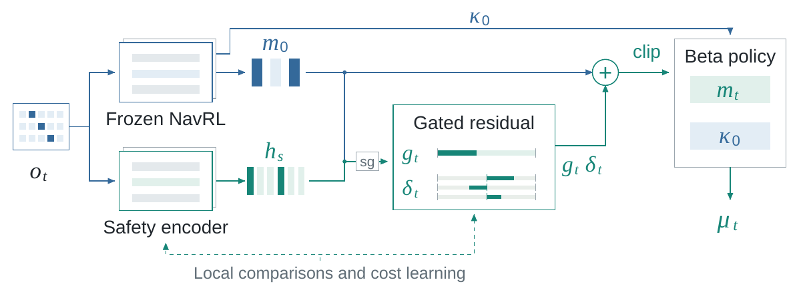

# RC-CF-NavRL

**Learning Bounded Velocity Corrections for UAV Navigation among Moving Obstacles**

Shenzhen Zhang and Shan Wang

[Figures and tables](manuscript/README.md) · [Recorded data](raw/README.md) · [Isaac Sim setup](simulation/README.md)



Across 5,760 paired episodes in the original cohort, success rose from **37.62% to 45.97%** and collisions fell from **59.53% to 52.15%** relative to matched PPO-Lagrangian. Effects in the released-checkpoint cohort were smaller, with 95% intervals spanning zero. [See both cohorts in Figure 4](manuscript/figures/figure-4.pdf).

## Reproduce on CPU

Use Python 3.10–3.12. The commands were tested on Linux with Python 3.12.

```bash
git clone https://github.com/shenzhen-zhang/RC-CF-NavRL-reproducibility.git
cd RC-CF-NavRL-reproducibility
python3 -m venv .venv
source .venv/bin/activate
python -m pip install -r requirements.txt
python analysis/reproduce.py --quick --output recomputed/quick
```

The quick run checks both navigation cohorts, flight geometry and latency. It also regenerates seven figures and all five tables. Run the full check to recompute the density, noise, unseen-layout, component ablation, velocity-obstacle deployment and teacher replay analyses.

```bash
python analysis/reproduce.py --output recomputed/full
```

Use a fresh output directory for each run. Statistics are saved there, figures go to `visuals/*/output/`, and LaTeX tables go to `visuals/tables/`.

## Find the files

| Task | Start here |
| --- | --- |
| Check a result from the paper | [Figure and table index](manuscript/README.md) links each result to its inputs and reproduction scripts. |
| Work with recorded experiments | [Raw data](raw/README.md) points to episode CSVs, replay NPZs, flight trajectories and timing repeats. [Field names and units](metadata/DATA_DICTIONARY.md) are documented. |
| Download weights or control-step traces | [Data archives](metadata/ARCHIVES.md) lists the large files and the command for the safety-cost analysis. |
| Rerun training or evaluation | [Isaac Sim setup](simulation/README.md) lists the entry points, pinned NavRL version and released-cohort settings. |

The released-checkpoint main comparisons use all 18 planned evaluation seeds. The wider released-checkpoint component analysis uses 17 shared seeds because five evaluation blocks are missing. Figure 9 uses archived seed-level summaries. The original five-seed cohort is represented by recorded evaluations. Its stage-0 and adapted checkpoints were unavailable in the checked backups. [See verification coverage](manuscript/README.md#analysis-coverage).

## Citation and license

Use [CITATION.cff](CITATION.cff) to cite the software. Project code is [MIT](LICENSE), and the data and author-created figures and tables are [CC BY 4.0](metadata/LICENSE-CC-BY-4.0.txt). Upstream code carries the [NavRL license](simulation/LICENSE.NavRL).
